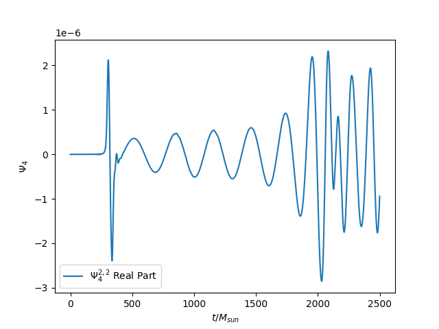

## Binary Neutron Star Merger Simulation

This project demonstrates an **equal-mass binary neutron star (BNS) merger simulation** using the [Einstein Toolkit](https://einsteintoolkit.org/). The setup is based on the [gallery example provided by the Einstein Toolkit team](https://einsteintoolkit.org/gallery/bns/index.html). 

Ran on the Pegasus cluster at IUCAA for 58 hrs on 256 cores.

The example simulation uses a **simple polytropic equation of state (EoS)**. The Einstein Toolkit now also has modules for **tabulated EoS**, as mentioned on their official website.

**Weyl Scalar ψ₄ (ℓ=2, m=2) at r = 300M**

The BNS simulation visualization can be found here 

**Note**: This is a low-resolution test simulation and does not accurately capture the microphysics in BNS mergers.
